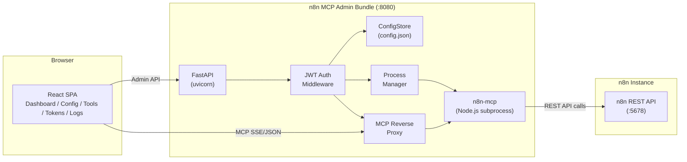
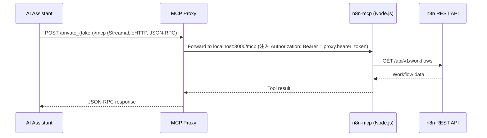
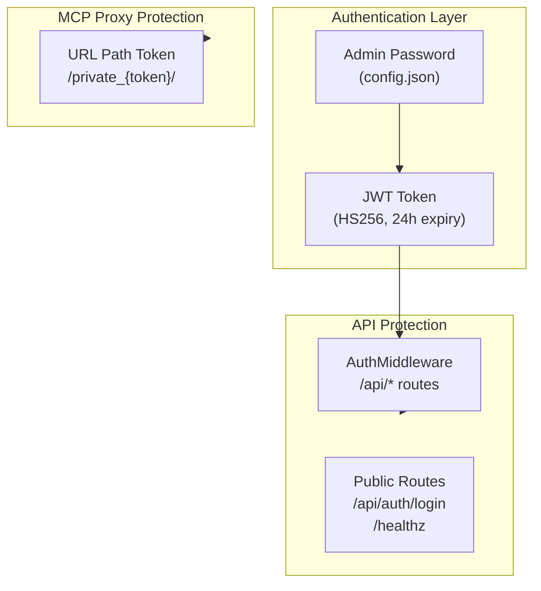

# Architecture

## System Overview

The n8n MCP Admin Bundle is a single-container solution that packages three components into one deployment unit:

1. **React SPA** (Frontend) -- Admin dashboard for managing n8n MCP server configuration
2. **FastAPI Backend** -- REST API + MCP reverse proxy + process manager
3. **n8n-mcp Server** (Node.js subprocess) -- MCP protocol server that interfaces with the n8n REST API

## Request Flow



## Component Details

### Frontend (React 19 + Tailwind CSS)

The frontend is a single-page application built with React 19, Tailwind CSS, and Vite. It provides seven views:

| Page | Description |
|------|-------------|
| Login | JWT-based authentication |
| Dashboard | System health overview (n8n, MCP server, proxy status) |
| Connection Config | n8n API URL and API Key configuration |
| Tool Manager | Enable/disable 24 MCP tools across 3 categories |
| Token Manager | MCP proxy token generation, rotation, and history |
| Log Viewer | Real-time SSE log streaming with search |
| Settings | Full config.json editor with MCP process control |

### Backend (FastAPI + Python 3.12)

The backend is split into two Python packages:

**mcp-admin-core** -- Shared library providing:
- `ConfigStore` -- File-backed JSON configuration persistence
- `McpProcessManager` -- asyncio subprocess lifecycle management
- `MCP Reverse Proxy` -- Token-validated reverse proxy with SSE streaming support
- `AuthMiddleware` -- JWT authentication for API endpoints
- `Settings Router` -- Full configuration CRUD

**n8n-mcp-admin** -- n8n-specific extension providing:
- `Connection Config Router` -- n8n API URL + API Key management with connectivity testing
- `Tool Manager Router` -- 24-tool registry with category-based enable/disable
- `Token Router` -- Proxy token generation, rotation, and history tracking
- `Health Router` -- Dashboard data aggregation (n8n version, workflow count, process status)
- `Log Router` -- In-memory ring buffer + SSE streaming

### n8n-mcp Server (Node.js)

The n8n-mcp server (`n8n-mcp` npm package, v2.61+) is a Node.js process managed by `McpProcessManager`. It:

- Started via the **`n8n-mcp-http` launcher**（console script，見 `n8n_mcp_admin/launcher.py`）：以 `npm root -g` 動態定位 n8n-mcp 的 **`dist/mcp/index.js`**，設 `MCP_MODE=http` + `HOST`/`PORT`、**不設** `USE_FIXED_HTTP` 後 exec node → 上游的 `SingleSessionHTTPServer`。（woow_paas_platform#1531：舊版跑的 `dist/http-server.js` 是 v2.31.8 起 deprecated 的固定 HTTP 模式，`resources/*`、`prompts/list`、`ping` 都回 -32601、沒有 SSE、不讀 session 設定。n8n-mcp 的 `n8n-mcp` bin 只跑 stdio。）
- command／args 由 `main.py` 的 `LaunchPolicy` 固定，管理頁改不了（#1530）；子行程只拿到白名單內的環境變數：`N8N_API_URL`、`N8N_API_KEY`、`AUTH_TOKEN`，以及由設定換算的 `SESSION_TIMEOUT_MINUTES`（Session Timeout 秒數無條件進位成分鐘；上游寫死每 5 分鐘清掃一次過期 session、收到請求時不檢查，所以實際在設定值之後 0–5 分鐘內才結束，最小有效粒度約 5 分鐘，映像建置時 `child_env.verify_upstream_session_sweep()` 會驗證這個週期，DATA-NMCP-003-3）、`N8N_MCP_MAX_SESSIONS`、`DISABLED_TOOL_OPERATIONS`（Permissions 頁）。預設 Session Timeout 900 秒、Max Sessions 20（2026-10-26 依實測每個 session 約 1.6～3.1 MiB 調整）。
- **名額已滿時由閘道回收 session**（`mcp_admin_core/session_reclaim.py`，`main.py` 的 `SESSION_RECLAIMER`）：閘道記下上游建立的每個 `Mcp-Session-Id` 與最後活動時間（進行中的 POST／DELETE 算使用中；GET 的 SSE 串流不算使用中、也不算活動——上游的 lastAccess 也只在 POST 更新，開著串流的 session 照樣逾時清掉，而 Claude Code 連上後一直開著 GET 串流）。已通過 MCP token 驗證的 `initialize` 收到上游 429「Session limit reached」時，閘道對最久沒活動、閒置超過 5 分鐘的 session 送 `DELETE /mcp`（上游立刻釋放名額、回 204），再重試；沒有可回收的才把 429 回給用戶端。回收＋重試在同一把鎖內，同時在等回收的 initialize 一個一個來；第一次嘗試的 initialize 不經過這把鎖，可能先用掉剛釋放的名額，這時重試又拿到「名額已滿」，閘道就再回收下一個（一個 initialize 最多 5 個 DELETE）。每 60 秒最多結束 10 個 session，共用 token 的用戶端不停重連也只能踢掉這麼多個閒置的 session。DELETE 沒有釋放名額（上游的認證限流 429、401、500 或送不出去）時，那個 session 還占著名額，紀錄保留、60 秒內不再對它回收（只有 204 與 404 才移除紀錄）。每次回收記一行 log（session id 只記雜湊前 8 碼、不含 token）。被結束的用戶端下次呼叫拿到 404：真的 Claude Code 2.1.310 實測會自己重新 initialize 並重試那次呼叫（重新連線時多開 1～2 個 session、結束時不送 DELETE）；Claude.ai 還沒實測。映像建置時 `child_env.verify_upstream_session_limit_reply()` 確認上游的 429 文字與 DELETE 行為沒變。
- Connects to the n8n REST API using the configured API URL and API Key（n8n-mcp 會以 SSRF 規則擋私網／loopback／metadata；管理頁的存檔（`PUT /api/config/connection` 與共用的 `PUT /api/settings/connection`，被擋回 400＋`detail.code="ssrf_blocked"`、不存檔）、測試連線與健康探測都用 `mcp_admin_core/util/ssrf.py`——擋／放決定對齊上游 n8n-mcp 的規則（含 permissive 也擋的 IPv6 metadata 與非標準 NAT64），訊息文字不一定逐字相同。帶帳號密碼的網址存檔與測試連線都拒絕；舊設定裡還留著的，launcher 拿掉帳密再交給 n8n-mcp（API Key 才是認證；原樣交給上游的話，n8n_health_check 與錯誤訊息會帶出帳密）並印一行提醒，主機部分含反斜線、無法確定主機的才不交給 n8n-mcp）
- Exposes MCP tools for AI assistants (Claude, ChatGPT, etc.)
- Communicates via **Streamable HTTP**（`/mcp`：POST JSON-RPC、GET SSE 串流、DELETE 結束 session；有 `Mcp-Session-Id`）。子行程重啟（改連線、改 Permissions）後舊 session 失效，用戶端依 MCP 規範重新 initialize。n8n-mcp http 模式**強制 `AUTH_TOKEN`**（無則 401）；proxy 轉發時代入。

## Data Flow



## Configuration Architecture

All configuration is stored in a single JSON file (`/data/config.json`):

```json
{
  "admin_password": "...",
  "mcp_auth_token": "...",
  "connection": {
    "n8n_api_url": "https://n8n.example.com",
    "n8n_api_key": "..."
  },
  "tools": {
    "disabled": [],
    "disabled_operations": {}
  },
  "mcp_server": {
    "command": "n8n-mcp-http",
    "args": ["--port", "3000"],
    "port": 3000,
    "env": {"AUTH_TOKEN": "<from Secret；n8n-mcp http 強制>"},
    "env_prefix": ""
  },
  "proxy": {
    "timeout": 86400,
    "bearer_token": "<同 mcp_server.env.AUTH_TOKEN；proxy 注入 Authorization: Bearer，client 只需 path token>"
  },
  "token_history": []
}
```

## Deployment Options

### Standalone (Podman/Docker)

Single container with a volume mount for persistent configuration:

```
podman run -p 8080:8080 -v ./data:/data ghcr.io/woowtech/n8n-mcp-admin:latest
```

### Docker Compose

Full stack with PostgreSQL + n8n + MCP Admin Bundle:

```
docker compose up -d
```

### Kubernetes

Deploy as a Deployment with RBAC, health probes, and resource limits. See `k8s-deploy.yaml`.

## Security Model



- **Admin GUI:** Protected by JWT authentication. Login with admin password, receive a 24-hour token.
- **MCP Proxy:** Protected by URL path token. AI assistants use `/private_{token}/` paths to access the MCP server.
- **MCP Server:** Not directly exposed. Only accessible through the authenticated reverse proxy.
